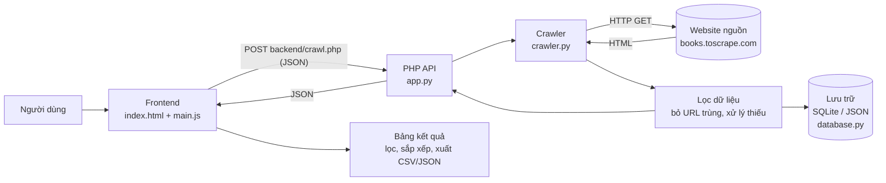
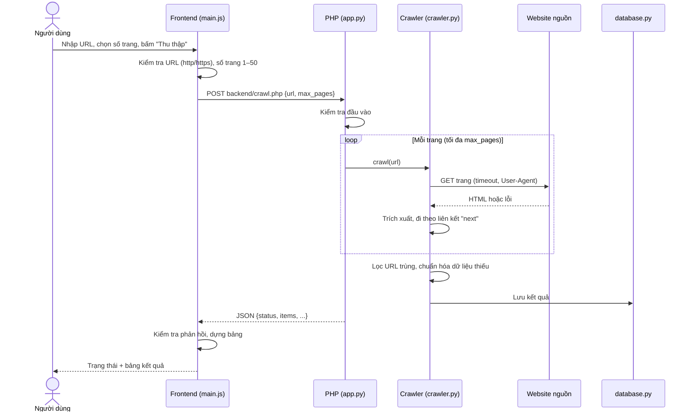
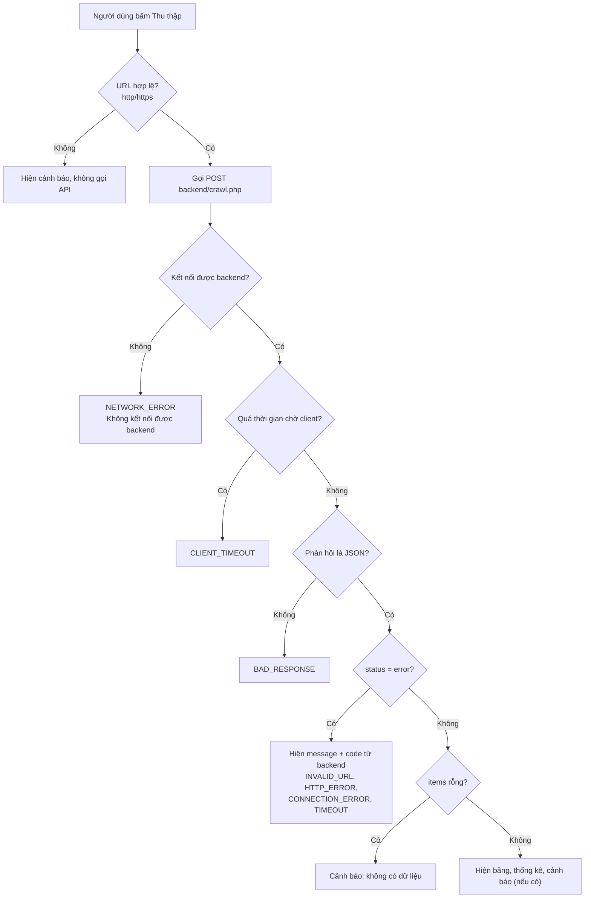

# Kiến trúc hệ thống và sơ đồ luồng xử lý

> Phụ trách tài liệu: Thành viên 2. Các sơ đồ viết bằng Mermaid, hiển thị trực tiếp trên GitHub, VS Code (cài extension Markdown Mermaid) hoặc https://mermaid.live.

## 1. Tổng quan

Hệ thống gồm 3 lớp:

1. **Frontend** (HTML, CSS, Bootstrap, JavaScript): nhận URL từ người dùng, gọi API, hiển thị trạng thái và bảng kết quả.
2. **Backend** (PHP): nhận yêu cầu, kiểm tra đầu vào, gọi crawler, trả JSON.
3. **Crawler và lưu trữ** (Requests, DOMDocument và XPath, SQLite/JSON): tải trang, trích xuất, lọc trùng, lưu dữ liệu.

## 2. Luồng xử lý chính (đúng yêu cầu đề bài)

**URL → crawler → lọc dữ liệu → lưu trữ → giao diện**

## 3. Luồng xử lý lỗi

## 4. Phân chia trách nhiệm theo tệp

| Tệp | Chủ trì | Nhiệm vụ |
|---|---|---|
| `app.py` | TV1 | PHP, route `/`, `backend/crawl.php`, `backend/results.php` |
| `crawler.py` | TV1 | Tải trang, phân tích HTML, phân trang, lọc trùng |
| `database.py` | TV1 + TV2 (thiết kế chung) | Lưu và truy vấn dữ liệu |
| `templates/index.html` | TV2 | Giao diện chính |
| `static/css/style.css` | TV2 | Định dạng |
| `static/js/main.js` | TV2 | Gọi API, hiển thị, lọc, sắp xếp, xuất dữ liệu |
| `docs/source_research.md` | TV2 | Khảo sát nguồn, hợp đồng API |
| `docs/architecture.md` | TV2 | Tài liệu này |
| `tools/mock_server.py`, `tools/ui_test.js` | TV2 | Công cụ kiểm thử giao diện khi chưa có backend |

## 5. Hợp đồng dữ liệu giữa frontend và backend

Chi tiết đầy đủ ở `docs/source_research.md`, mục 7. Tóm tắt:

- Yêu cầu: `POST backend/crawl.php` với `{"url": "...", "max_pages": 1}`.
- Thành công: `{"status": "success", "items": [...], "pages_crawled", "total_found", "duplicates_removed", "warnings"}`.
- Lỗi: `{"status": "error", "code": "...", "message": "..."}` với HTTP 400, 502 hoặc 504.
- Mỗi `item`: `title`, `url`, `price`, `currency`, `rating`, `availability`, `image_url`.

## 6. Thiết kế giao diện

| Khu vực | Mô tả | Yêu cầu đề bài |
|---|---|---|
| Form | Ô nhập URL, số trang tối đa, nút "Thu thập", hai URL ví dụ | Ô nhập URL, nút bắt đầu |
| Trạng thái | Thông báo đang xử lý (spinner, nút bị khóa), thành công, thất bại có mã lỗi | Hiển thị trạng thái |
| Thống kê | Số mục, số trang, số URL trùng đã loại, thời gian | Kết quả lọc trùng |
| Bảng kết quả | Ảnh, tiêu đề (liên kết), giá, sao, tình trạng, URL; có lọc theo tiêu đề, sắp xếp theo cột, xuất JSON/CSV | Bảng hiển thị dữ liệu crawler trả về |
| Dữ liệu đã lưu | Thẻ hiện số mục đã lưu và nút xem lại (tự ẩn nếu backend chưa có `backend/results.php`) | Chuẩn bị cho tuần 2 |

Giao diện không chứa dữ liệu mẫu; mọi dữ liệu trong bảng đều đến từ phản hồi của backend.

## 7. Bảo mật và an toàn phía giao diện

- Mọi chuỗi từ backend đều được **escape HTML** trước khi chèn vào bảng, ngăn XSS nếu trang nguồn chứa mã độc.
- Liên kết và ảnh chỉ được dùng khi có giao thức `http`/`https`, loại bỏ `javascript:` và `data:`.
- Liên kết ngoài mở với `rel="noopener noreferrer"`.
- Xuất CSV thêm dấu `'` trước ô bắt đầu bằng `=`, `+`, `-`, `@` để tránh *CSV/formula injection* khi mở bằng Excel; thêm BOM để Excel đọc đúng tiếng Việt.
- Có thời gian chờ phía client (20 giây + 4 giây mỗi trang) để giao diện không treo.

## 8. Kế hoạch và kết quả kiểm thử giao diện

Kiểm thử tự động bằng jsdom (`tools/ui_test.js`) chạy trên `tools/mock_server.py`: **32/32 kiểm tra đạt** ngày 11/10/2026.

| Nhóm | Nội dung kiểm tra | Kết quả |
|---|---|---|
| Đầu vào | URL sai, `ftp://`, `max_pages=99` bị chặn trước khi gọi API | Đạt |
| Đối chiếu | Số dòng, tiêu đề (đúng thứ tự), giá, liên kết trong bảng khớp JSON backend | Đạt |
| Thống kê | Số mục, số trang, số trùng, cảnh báo | Đạt |
| Tương tác | Lọc, sắp xếp giá tăng/giảm, sắp xếp tiêu đề | Đạt |
| Xuất dữ liệu | CSV (BOM, đủ dòng, escape dấu phẩy), JSON | Đạt |
| Lỗi | TIMEOUT, HTTP_ERROR, CONNECTION_ERROR, phản hồi không phải JSON, dữ liệu rỗng, backend không chạy | Đạt |
| Bảo mật | XSS qua tiêu đề, href `javascript:`, CSV formula injection | Đạt |

**Giới hạn của kiểm thử này**: dùng dữ liệu giả lập và môi trường jsdom, chưa chạy trên trình duyệt thật và chưa chạy với crawler thật của TV1. Còn phải làm khi có backend: chạy cả luồng với `books.toscrape.com`, đối chiếu dữ liệu với trang gốc, chụp ảnh màn hình trên cả hai máy (mục 9).

## 9. Bằng chứng kiểm thử cần bổ sung (lưu trong `evidence/`)

1. Ảnh màn hình trang chủ khi vừa mở.
2. Ảnh đang thu thập (spinner, nút bị khóa).
3. Ảnh kết quả thành công với bảng dữ liệu.
4. Ảnh lỗi URL sai và lỗi mạng/timeout.
5. Ảnh file JSON/CSV vừa xuất.
6. Ảnh chạy trên máy còn lại của nhóm.
7. Ảnh đối chiếu 3 mục ngẫu nhiên giữa bảng và trang books.toscrape.com thật.
